<p align="center">
  
</p>

<p align="center">
  <strong>Descubra. Avalie. Organize. Compartilhe.</strong>
</p>

## Sobre o projeto

O **CINEA** é uma aplicação mobile de cinema desenvolvida em **React Native e Expo**, no contexto acadêmico da **FIAP**. O aplicativo reúne descoberta de filmes, avaliações e organização de Tier Lists com compartilhamento nativo.

O **CP5** estabeleceu autenticação, persistência com Supabase e os fluxos com catálogo local. O **CP6** integra o catálogo real do TMDB, preserva os dados legados, refina a interface com um design system semântico e entrega exportação de Tier Lists em imagem.

A primeira build APK via EAS foi instalada e validada no Android Emulator. A validação de iOS não faz parte desta entrega.

## 👥 Integrantes

| Integrante | RM | Função |
|---|---|---|
| Victor Hugo de Paula | RM554787 | **Design** (Identidade Visual, UI/UX e Prototipagem) |
| Otavio Santos de Lima Ferrao | RM556452 | **Product Owner** (Gestão de Produto e Escopo) |
| Felipe Carioba | RM558447 | **Dev Front** (Implementação Mobile React Native) |
| Djalma Andrade | RM555530 | **Dev Back/Mock** (Estruturação de Dados e Lógica) |
| Lucas Rodrigues | RM556323 | **QA** (Garantia de Qualidade e Testes) |

## Escopo e proposta de valor

A descoberta de filmes, a leitura de opiniões e a criação de rankings costumam exigir ferramentas separadas. O CINEA aproxima essas atividades em uma experiência visual e compartilhável.

O público-alvo inclui jovens adultos, cinéfilos e usuários casuais que desejam descobrir títulos e organizar suas preferências. A proposta original também contempla disponibilidade em streaming e interação social; esses recursos permanecem planejados quando ainda não implementados.

## 🎨 Desenvolvimento de Marca e Identidade Visual

A marca e a interface do **CINEA** foram idealizadas para transmitir a atmosfera imersiva de um cinema clássico. 

* **Nome e Logo:** O nome CINEA remete à essência do cinema com uma sonoridade premium. O conceito do logotipo brinca com o espaço negativo, onde um feixe de luz projetado por um refletor revela a silhueta de um espectador no formato da letra "A", colocando o usuário da comunidade sob os holofotes.
* **Paleta de Cores e Tipografia:** A interface utiliza um fundo degradê em tons de vermelho escuro (simulando cortinas de teatro), contrastando com detalhes funcionais e avaliações em amarelo iluminado.

## 📱 Protótipo no Figma

A interface e a identidade visual do **CINEA** foram desenvolvidas e prototipadas utilizando o **Figma**.

O protótipo apresenta as principais telas e fluxos planejados para o aplicativo, permitindo visualizar a experiência do usuário antes da implementação em React Native.

### Telas desenvolvidas

- Tela de Login;
- Tela Inicial;
- Tela de Filme;
- Tela de Avaliações;
- Tela de Avaliação;
- Tela de Pesquisa;
- Tela de Usuário;
- Menu do Usuário;
- Tela de Tier List.

### Acessar o protótipo

<p align="center">
  <a href="https://www.figma.com/design/YkjmqKSaibpFj0yNBNTiOU/CINEA---Mobile-Development-and-IoT?node-id=0-1&p=f">
    <strong>🎨 Visualizar protótipo no Figma</strong>
  </a>
</p>

## Funcionalidades

### Autenticação e conta

- Cadastro, login e persistência de sessão com Supabase Auth.
- Perfil com nome, username, bio e filmes avaliados.
- Edição de perfil e avatar da galeria, com upload e fallback visual.
- Configurações de conta, alteração de senha autenticada e logout com loading/erro.
- Informações do app, versão e créditos TMDB.

### Filmes

- Catálogo real pela API TMDB: populares, em cartaz, pesquisa e detalhes.
- Home com seções Em alta, Em cartaz e Descobrir.
- Busca com debounce, paginação e estados de loading, vazio, erro e retry.
- Detalhes com poster, metadados, sinopse, avaliações e compartilhamento nativo.
- A ação “Assistir agora” informa disponibilidade futura; providers de streaming ainda não são consultados.

### Avaliações

- Publicação de nota de 1 a 5 e comentário, persistidos no Supabase.
- Avaliações por filme e tela Minhas avaliações.
- Após publicar, navegação para Minhas avaliações com atualização ao receber foco.
- Enriquecimento de títulos/posters via TMDB, com fallback dos dados persistidos.
- Compatibilidade com filmes e IDs legados.

### Tier Lists

- Criação, leitura, edição e exclusão com confirmação; suporte a múltiplas listas.
- Organização em S/A/B/C/D, busca de filmes TMDB e seleção de tier.
- Movimentação, ordenação e remoção pelo action sheet dos itens.
- Deduplicação por identidade equivalente entre IDs legados e TMDB.
- Exportação PNG com título, descrição, tiers e posters, usando composição própria.
- Compartilhamento pelo share sheet nativo, sem salvar automaticamente na galeria.
- Posters ausentes ou indisponíveis usam fallback.

## Tecnologias

- React Native 0.81.5, React 19 e Expo SDK 54.
- TypeScript e React Navigation (Native Stack e Bottom Tabs).
- Supabase Auth, PostgreSQL, Storage e Row Level Security (RLS).
- TMDB API.
- AsyncStorage para persistência de sessão, `@supabase/supabase-js` e `react-native-url-polyfill`.
- `expo-image-picker`, `react-native-safe-area-context` e `react-native-screens`.
- `react-native-view-shot` e `expo-sharing` para exportação e compartilhamento.
- Expo Application Services (EAS Build) para distribuição Android.

## Estrutura do projeto

O aplicativo está em `cinea/`:

```text
cinea/
  assets/            # imagens e assets locais
  design-reference/  # referência visual do Figma
  src/
    components/      # componentes compartilhados de interface
    screens/         # telas organizadas por domínio
    navigation/      # stacks, tabs e rotas
    services/        # acesso a APIs, identidade e persistência
    hooks/           # paginação, enriquecimento e estado reutilizável
    types/           # contratos TypeScript
    tokens/          # design tokens legados e semânticos
    config/          # configuração do catálogo TMDB
    data/            # mapping legado e dados locais remanescentes
    lib/             # cliente Supabase
  supabase/          # schema e políticas RLS de referência
  scripts/           # validadores locais
  docs/              # plano de testes e evidências
  app.json           # configuração Expo/Android
  eas.json           # perfis de distribuição
```

## Design system

A identidade originada no Figma foi preservada: fundo vinho/vermelho, texto creme e acentos laranja/amarelo. `src/tokens/` organiza cores, spacing, typography, radius, sizes e states semânticos, mantendo compatibilidade com os tokens legados.

Componentes como `CineaScreen`, `ScreenHeader`, `PrimaryButton`, `CineaInput`, `CineaState`, `MoviePosterCard`, `ReviewCard` e `AccountMenuRow` padronizam telas, formulários, estados e hierarquia visual.

## Supabase

O Supabase é responsável por autenticação e sessão, `profiles`, `reviews`, `tier_lists`, `tier_list_items` e armazenamento de avatars. Os dados são associados ao usuário autenticado; os itens pertencem à Tier List e sua exclusão acompanha o relacionamento configurado no banco.

RLS controla o acesso conforme usuário e ownership. Avatars usam o bucket privado `avatars`, organização por usuário e signed URLs temporárias, com fallback quando não há foto.

As referências de schema e políticas estão em [schema.sql](./cinea/supabase/schema.sql) e [rls.sql](./cinea/supabase/rls.sql). A integração do CP6 preserva o schema/RLS existente.

## TMDB e compatibilidade legada

Home, busca e detalhes utilizam endpoints de filmes populares, em cartaz, pesquisa e detalhes do TMDB, incluindo posters e informações em português quando disponíveis.

Novos itens utilizam IDs TMDB canônicos como string. O resolver e o mapping legado mantêm avaliações e Tier Lists antigas funcionando sem exigir backfill. Falhas de enriquecimento preservam títulos salvos e placeholders.

> This product uses the TMDB API but is not endorsed or certified by TMDB.

## Instalação

Requer Node.js/npm e um ambiente Expo compatível. EAS não é obrigatório para desenvolvimento local.

```powershell
git clone https://github.com/djxlma/Cinea_App
cd Cinea_App/cinea
npm install
Copy-Item .env.example .env
```

Em outros shells, use `cp .env.example .env`. Preencha o arquivo local conforme a próxima seção.

## Variáveis de ambiente

Use `cinea/.env.example` como modelo. São necessárias:

- `EXPO_PUBLIC_SUPABASE_URL`
- `EXPO_PUBLIC_SUPABASE_ANON_KEY`
- `EXPO_PUBLIC_TMDB_READ_TOKEN`

O arquivo `.env` é ignorado pelo Git e não deve ser commitado. O template contém somente os nomes, sem valores reais.

## Execução

Dentro de `cinea/`:

```powershell
npx.cmd expo start
```

Em outros ambientes, use `npx expo start`. Execute com Expo Go compatível com o SDK do projeto ou com o ambiente de desenvolvimento Android. Com um Android Emulator aberto e configurado, use a opção Android do Expo (`a`).

A entrega foi validada em Android Emulator; não se afirma validação em iOS.

## Build Android

O projeto está vinculado ao EAS e possui os perfis:

- **preview**: distribuição interna, ambiente `preview`, APK instalável.
- **production**: ambiente `production`, AAB para distribuição futura pela Play Store.

Antes da build, autentique no EAS e confira as três variáveis de ambiente do projeto no ambiente `preview`:

- `EXPO_PUBLIC_SUPABASE_URL`
- `EXPO_PUBLIC_SUPABASE_ANON_KEY`
- `EXPO_PUBLIC_TMDB_READ_TOKEN`

O `.env` local não deve ser versionado para disponibilizar configurações à nuvem. Cadastre as variáveis no painel EAS. Uma build de produção requer os valores correspondentes no ambiente `production`.

```powershell
npx.cmd eas-cli@latest build --platform android --profile preview
```

Para AAB futuro:

```powershell
npx.cmd eas-cli@latest build --platform android --profile production
```

Em outros shells, substitua `npx.cmd` por `npx`.

Primeiro APK instalado e testado no Android Emulator:

- Package: `com.cinea.app`
- Version: `1.0.0`
- VersionCode: `1`

Os assets de icon, adaptive icon e splash ainda são provisórios; isso não impediu a validação técnica do APK.

## Validação

No fechamento do CP6: **TypeScript PASS**, **Expo Doctor 18/18** e validadores de Reviews, Tier Lists e Account/Settings aprovados.

Dentro de `cinea/`:

```powershell
npx.cmd tsc --noEmit
npx.cmd expo-doctor
node scripts/validate-review-migration.cjs
node scripts/validate-tierlist-migration.cjs
node scripts/validate-account-settings.cjs
```

Os scripts verificam cenários de identidade legado/TMDB, deduplicação, fallback, persistência segura e validações de conta. Não representam cobertura automatizada completa nem substituem testes manuais no dispositivo.

O [plano de testes](./cinea/docs/test-plan.md) e o [checklist de evidências](./cinea/docs/evidence-checklist.md) preservam os registros do CP5. As evidências abaixo são históricas; os refinamentos do CP6 e o APK foram validados adicionalmente no Android Emulator.

## Segurança

- Sessão gerenciada pelo Supabase Auth e acesso a dados protegido por RLS.
- A aplicação mobile não utiliza chave `service_role`.
- `.env`, credenciais e arquivos de assinatura não devem ser versionados.
- Variáveis `EXPO_PUBLIC_*` são incluídas no bundle e podem ser lidas no client.
- A chave anon do Supabase e o token TMDB utilizado no client não são segredos de backend. A autorização dos dados depende das políticas do servidor.
- Um proxy/backend para chamadas TMDB é uma melhoria prevista para produção.

## Próximos passos

- Conexões entre usuários: planejadas, sem backend de conexões implementado.
- Proxy/backend para chamadas TMDB em produção.
- Melhorias de descoberta e recomendações.
- Providers reais para “Assistir agora” e edição/exclusão de reviews.
- Persistência transacional de Tier Lists, além das proteções atuais contra falhas parciais.
- Finalização dos assets de distribuição e refinamentos adicionais de release.

## 💼 Ideia de Venda (Pitch)

Este pitch descreve possibilidades futuras de negócio; assinaturas, limites premium, anúncios e afiliação não estão implementados.

### Modelo de Negócios
Para garantir viabilidade e rápida adoção, o CINEA operará em um modelo híbrido:
1. **Freemium:** Acesso gratuito às ferramentas centrais da comunidade (avaliar filmes, buscar streamings, criar um número limitado de Tier Lists).
2. **Assinatura Premium:** Plano mensal voltado a *heavy users*, liberando Tier Lists ilimitadas, customização avançada de perfil e exportação em alta resolução sem anúncios.
3. **Afiliados (B2B):** Monetização via comissionamento (CPA) ao redirecionar usuários para a assinatura de serviços de streaming parceiros.

### Diferencial Competitivo
Enquanto as plataformas do mercado atual se limitam a listas textuais e notas numéricas, o CINEA integra a criação de **Tier Lists Nativas**. Isso gera um formato visual dinâmico, pronto para exportação e desenhado para o compartilhamento orgânico em redes sociais, mantendo o usuário engajado sem precisar de softwares de terceiros.

## 📸 Evidências do CP5

### 🔐 Autenticação

<p align="center">
  
  &nbsp;&nbsp;
  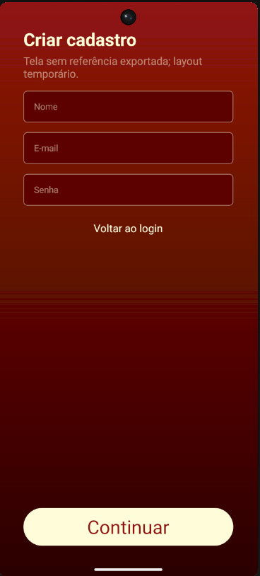
</p>

### 🏠 Descoberta de Filmes

<p align="center">
  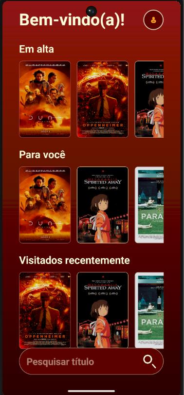
  &nbsp;
  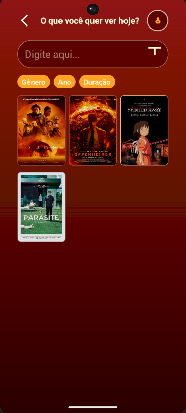
  &nbsp;
  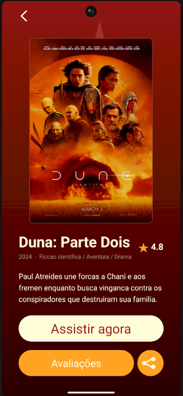
</p>

### ⭐ Avaliações

<p align="center">
  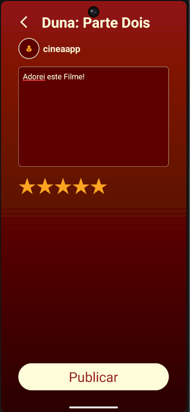
  &nbsp;
  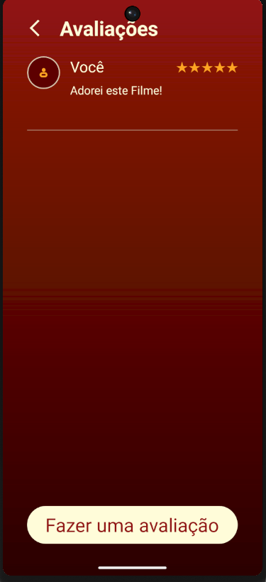
  &nbsp;
  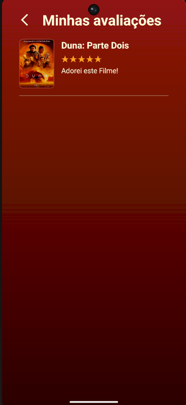
</p>

### 👤 Perfil

<p align="center">
  
</p>

### 🏆 Tier Lists

<p align="center">
  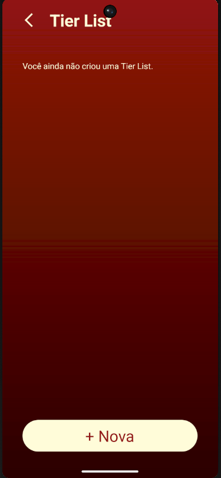
  &nbsp;
  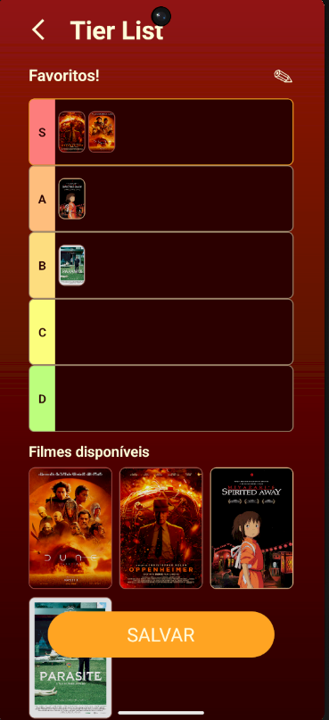
  &nbsp;
  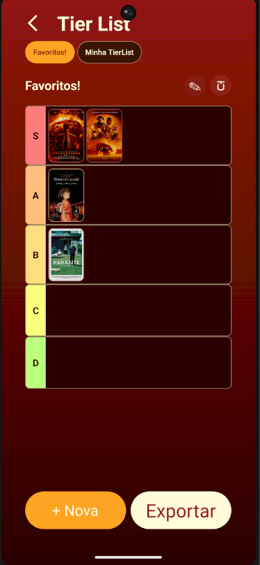
</p>

### 🗄️ Persistência no Supabase

#### Reviews

<p align="center">
  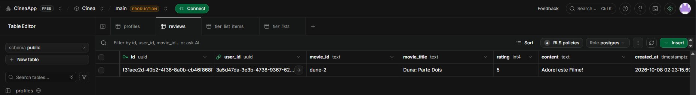
</p>

#### Tier Lists

<p align="center">
  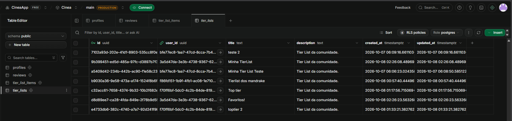
</p>

#### Itens das Tier Lists

<p align="center">
  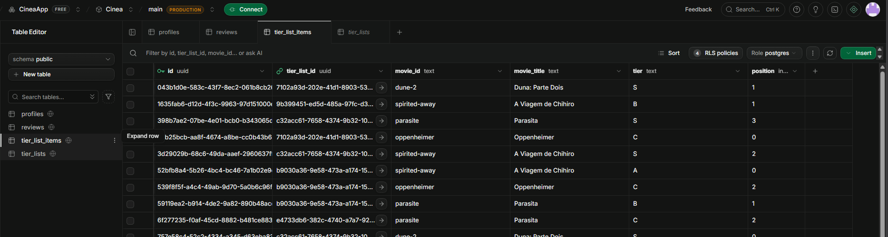
</p>

### 🔐 Segurança / RLS

<p align="center">
  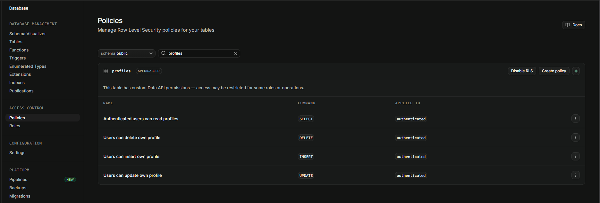
</p>

> As capturas do Supabase devem ocultar informações sensíveis, como credenciais, tokens, chaves e dados pessoais.
